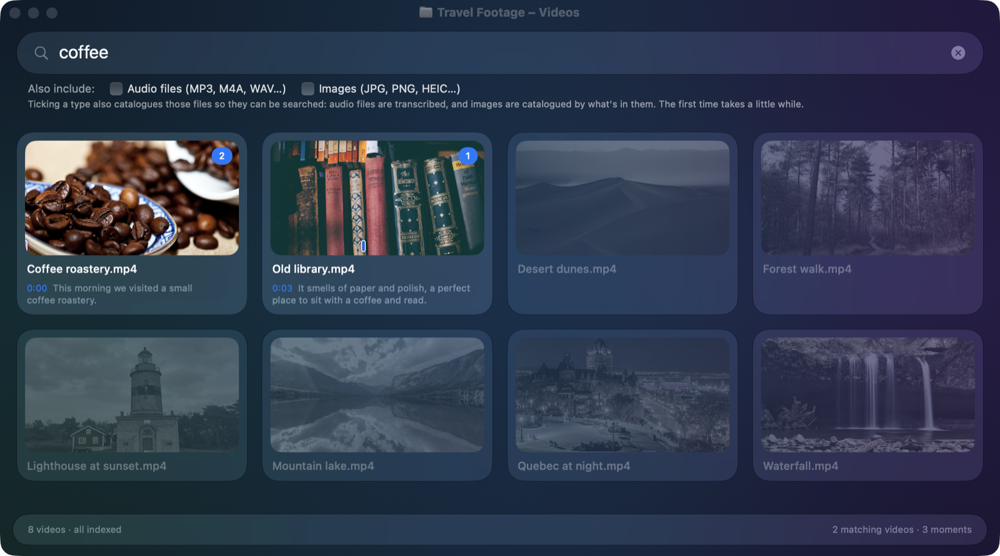
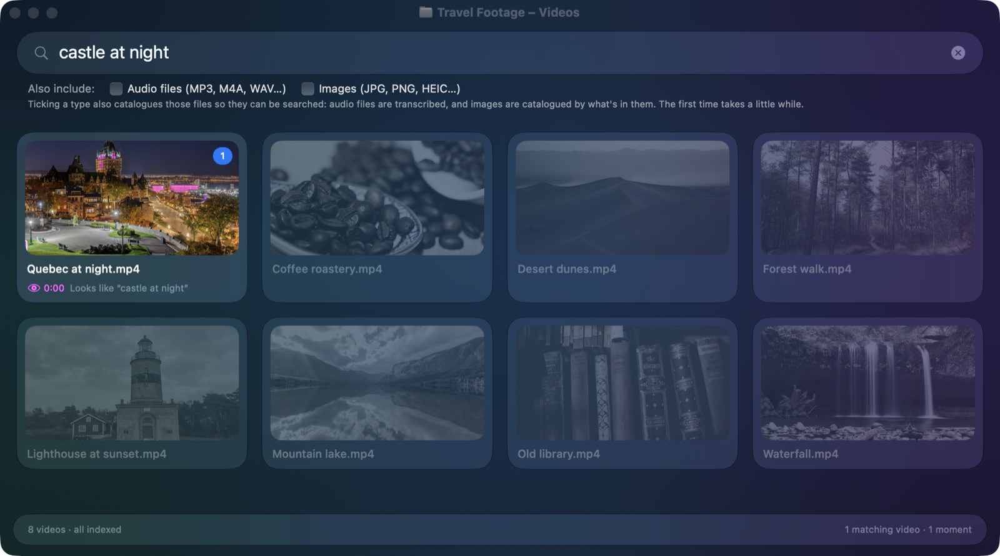
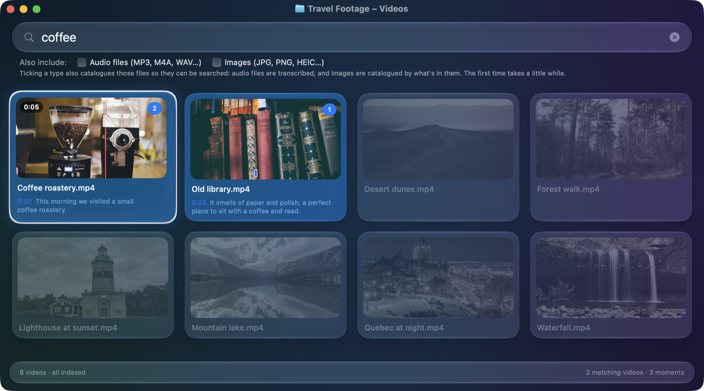
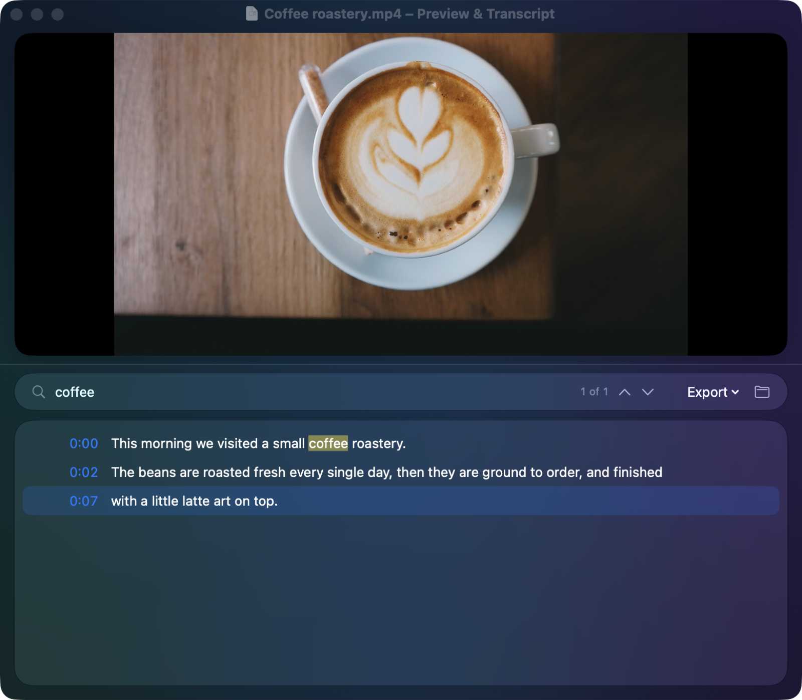
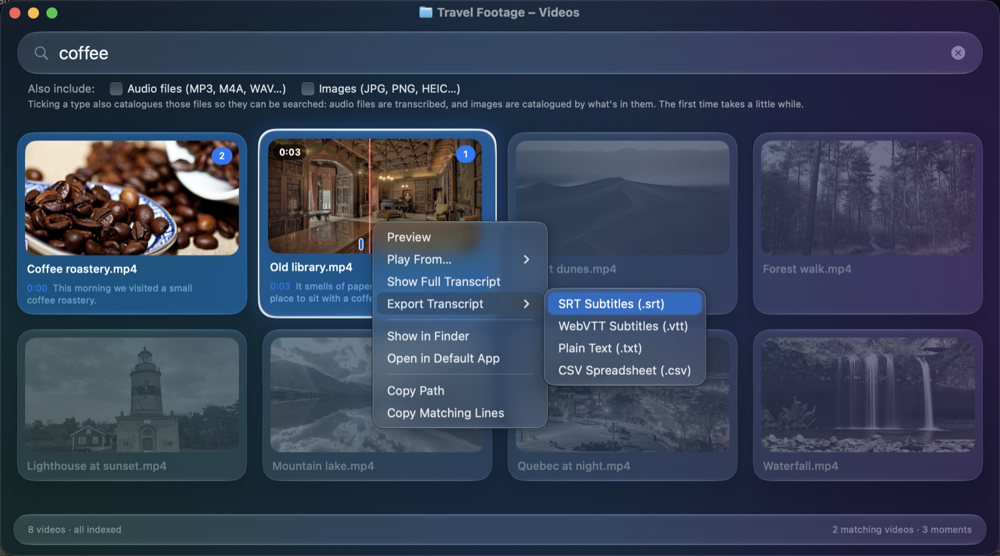
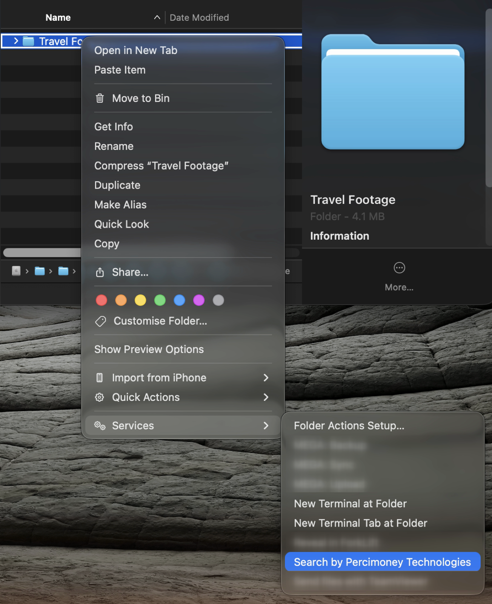

  

<h1 align="center">Search by Percimoney Technologies</h1>

  <b>Find any moment in your videos by what's said or shown.</b> 
  Right-click a folder, type a word, and jump straight to the moment.

  <a href="https://github.com/kendalpercimoney/search-by-percimoney-technologies-updates/releases/latest"><b>⬇︎ Download for Mac (free)</b></a>
  &nbsp;·&nbsp;
  <a href="https://buymeacoffee.com/kenpercimoney">☕ Buy me a coffee</a>

  

## What it does

Search by Percimoney Technologies turns a folder of videos into something you can search like a document. It listens to every video and looks at every scene, so you can find a moment by the words spoken or by what's on screen. Everything runs on your Mac: nothing is uploaded.

### Search what was said

Type a word and see every video where it's spoken, with the exact moment and the line around it. Works in many languages.

### Search what was shown

Describe a scene, like *castle at night*, *snowy mountains* or *a cup of coffee*, and it finds the videos where it appears, even if nobody mentions it. Visual matches are marked with an eye.

  

### Skim without opening anything

Move your pointer across a video to skim through it. Press Space to play it right in the grid.

  

### Read along, and jump anywhere

Open a video to watch it next to its full transcript. Your search words are highlighted, and clicking any line jumps the video there.

  

### Export subtitles and transcripts

Save any video's words as subtitles (SRT, WebVTT), plain text, or a spreadsheet (CSV). You can export one video or the whole folder at once.

  

### Right where you need it

In Finder, right-click any folder and choose **Services → Search by Percimoney Technologies**.

  

## Also

- **Private:** your videos never leave your Mac, and it works offline. The only thing it fetches from the internet is app updates.
- **Fast:** a folder is catalogued in the background, and you can search while it works. Pause any time; it picks up where it left off.
- **Audio and photos too:** tick a box to also search MP3s and other audio files, or photos by what's in them.
- **Keeps itself up to date:** it tells you when there's a new version, and updates in one click.

## Install

1. **[Download the latest version](https://github.com/kendalpercimoney/search-by-percimoney-technologies-updates/releases/latest)** and open the `.dmg` file under *Assets*.
2. Drag the app into **Applications**.
3. The first time, right-click the app and choose **Open**, then **Open** again. macOS asks this for apps from outside the App Store.
4. The welcome guide walks you through the rest.

**Needs:** a Mac with Apple silicon (M1 or later) and macOS 14 Sonoma or later. About 420 MB of disk space; the speech and image models are built in, so nothing else is downloaded.

## How it works

Speech is transcribed on your Mac with [Whisper](https://github.com/openai/whisper), running on the Neural Engine through [WhisperKit](https://github.com/argmaxinc/WhisperKit). Scenes are understood with Apple's [MobileCLIP](https://github.com/apple/ml-mobileclip), which matches your words to what's in each shot. Each folder keeps its search index in a small hidden file next to the videos, so searches are instant and nothing has to be re-done.

## Support

The app is free. If it saves you time, you can **[buy me a coffee ☕](https://buymeacoffee.com/kenpercimoney)**. It keeps the updates coming.

## Licence

Free to use, all rights reserved. You may use the app on your own Macs, but not resell or redistribute it. Please share this page instead of the file. The full licence is in the disk image and in the app (Help → Licence), and the open-source parts it uses are listed under Help → Acknowledgements.

This repository holds the app's releases. Screenshots use public-domain (CC0) photos from Wikimedia Commons.
